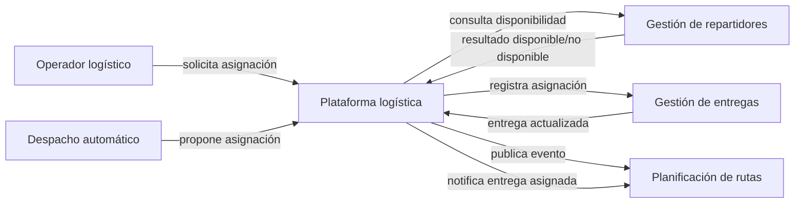
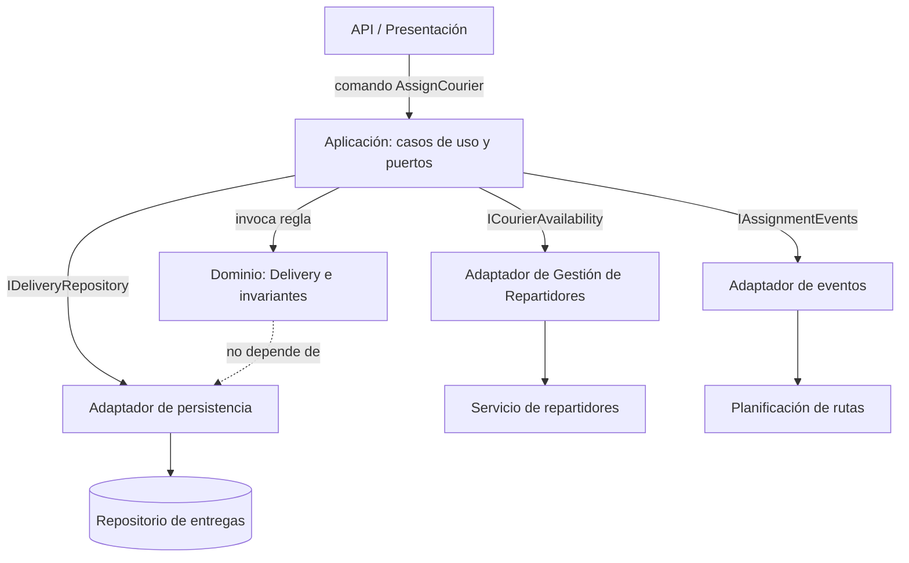

# Architecture

## Alcance

Este documento describe el diseño de `AssignCourierUseCase`, acotado al contexto de despacho/asignación de última milla. La persistencia y las integraciones externas se representan mediante contratos; su implementación se reserva para la Actividad 4.

## C4 nivel 1 · Contexto

## C4 nivel 2 · Contenedores lógicos

## Componentes y dirección de dependencias

- **Domain:** `Delivery`, `DeliveryId`, `DeliveryAddress`, `CourierId`, `DeliveryStatus`. Sin dependencias de frameworks, ORM, HTTP o proveedores.
- **Application:** `AssignCourierUseCase` coordina la intención y define los puertos `IDeliveryRepository`, `ICourierAvailability` e `IAssignmentEvents`.
- **Infrastructure:** en Actividad 4 implementará esos puertos con almacenamiento, API/servicio de repartidores y mensajería.
- **Presentation:** convierte la solicitud externa en un comando de aplicación y traduce los resultados en respuestas.

El código fuente depende hacia dentro: Presentation/Infrastructure → Application → Domain. Los adaptadores implementan contratos definidos por Application. La entidad de dominio protege sus reglas sin conocer el mecanismo de almacenamiento.

## Contrato del caso de uso

`AssignCourier(deliveryId, courierId)` valida existencia de la entrega, disponibilidad del repartidor y capacidad de ruta; solicita `Delivery.AssignCourier`, guarda la entidad y registra `DeliveryAssigned`. Los errores esperados incluyen `DeliveryNotFound`, `CourierUnavailable`, `RouteCapacityExceeded` y `DeliveryAlreadyAssigned`.

La publicación confiable del evento debe resolverse con una transacción/outbox en la Actividad 4. El modelo aquí no presupone una tecnología concreta.

## Límites y preguntas abiertas

- ¿“Repartidor activo” significa disponible, habilitado, o asignado a otra entrega en curso?
- ¿La disponibilidad se consulta en Gestión de Repartidores o en Planificación de Rutas?
- ¿La capacidad se valida por ruta, vehículo, zona o límite individual?
- ¿Una entrega puede reasignarse después de cancelación o incidencia? La regla actual solo permite asignación cuando no existe repartidor activo.
- El escenario base del texto pegado omite la consulta de disponibilidad y el límite de ruta saturada que pide el PDF; esta propuesta los incorpora como puertos y reglas previas.

