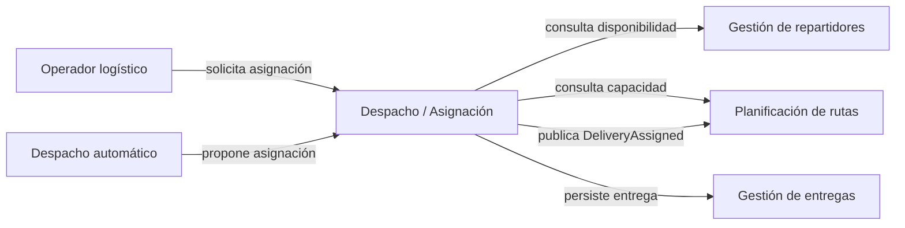
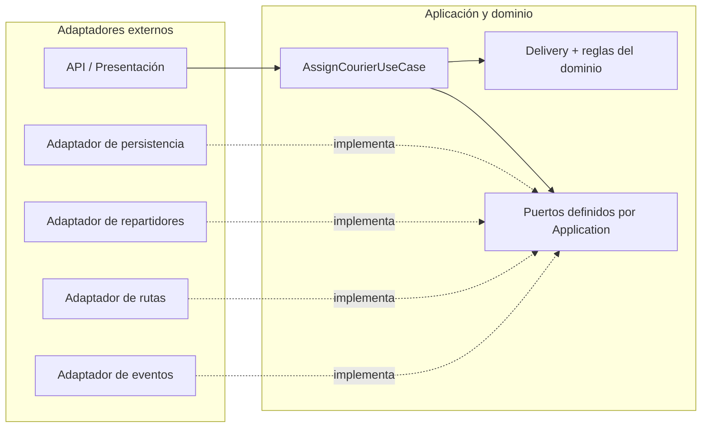

# Arquitectura Onion

## Flujo delimitado

`AssignCourierUseCase` asigna un repartidor elegible a una entrega pendiente. El dominio protege la regla de no duplicar una asignación. Application consulta disponibilidad y capacidad mediante puertos, guarda el cambio y registra `DeliveryAssigned`.

## Capas Onion

```text
┌──────────────────────────────────────────────────────────────┐
│ PRESENTACIÓN + INFRAESTRUCTURA                               │
│ API · persistencia · repartidores · rutas · eventos           │
│  ┌────────────────────────────────────────────────────────┐  │
│  │ APLICACIÓN                                              │  │
│  │ AssignCourierUseCase · puertos · contratos              │  │
│  │  ┌──────────────────────────────────────────────────┐  │  │
│  │  │ SERVICIOS Y POLÍTICAS DE DOMINIO                  │  │  │
│  │  │ reglas que coordinan conceptos del negocio        │  │  │
│  │  │  ┌────────────────────────────────────────────┐  │  │  │
│  │  │  │ MODELO DE DOMINIO                          │  │  │  │
│  │  │  │ Delivery · IDs · estados · invariantes     │  │  │  │
│  │  │  └────────────────────────────────────────────┘  │  │  │
│  │  └──────────────────────────────────────────────────┘  │  │
│  └────────────────────────────────────────────────────────┘  │
└──────────────────────────────────────────────────────────────┘
```

**Regla de dependencias:** las referencias de código apuntan hacia el centro. `Domain` no conoce Application, API, ORM ni proveedores externos. Application define `IDeliveryRepository`, `ICourierAvailability`, `IRouteCapacity` e `IAssignmentEvents`. Los adaptadores externos implementan esos contratos. En ejecución, el caso de uso invoca las interfaces inyectadas; la dirección de las dependencias de código se mantiene hacia adentro.

## C4 nivel 1 · Contexto



## C4 nivel 2 · Componentes y dependencias



## Secuencia del caso de uso

1. Cargar `Delivery` por `IDeliveryRepository`.
2. Consultar `ICourierAvailability`.
3. Consultar `IRouteCapacity`.
4. Ejecutar `Delivery.AssignCourier(courierId)`.
5. Guardar por `IDeliveryRepository`.
6. Registrar `DeliveryAssigned` por `IAssignmentEvents`.

Si alguna validación falla, no se modifica la entrega ni se registra el evento. En la Actividad 4 se deberá resolver la atomicidad entre guardar la asignación y publicar el evento (por ejemplo, con outbox), además de evitar carreras entre consultar capacidad y confirmar la asignación.

