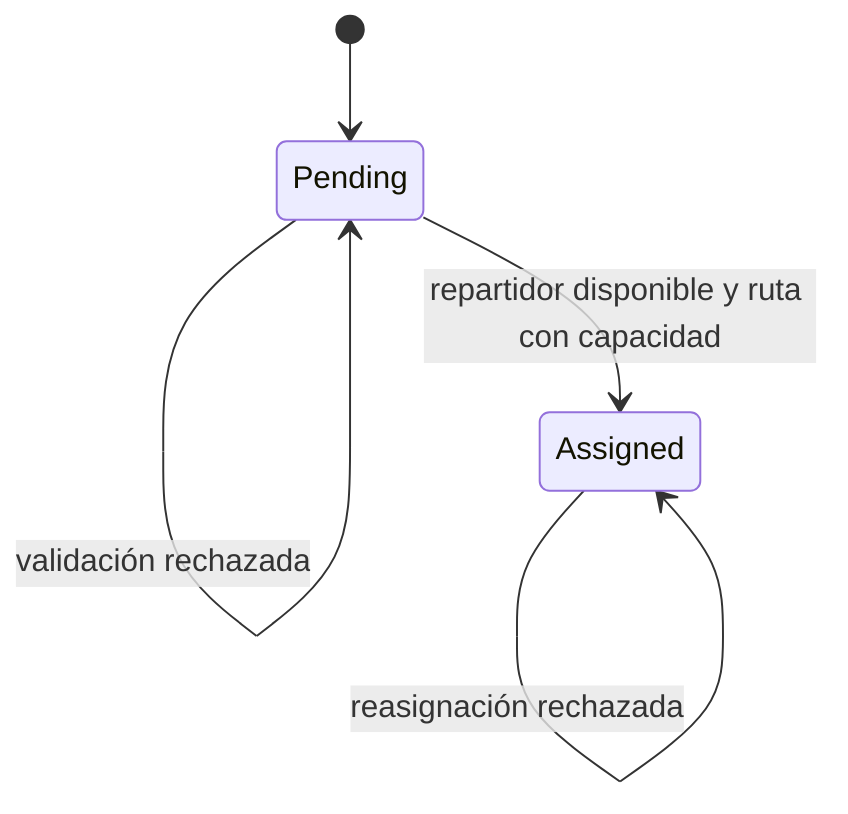

# Modelo de dominio y lenguaje ubicuo

## Agregado `Delivery`

| Campo | Tipo | Significado |
|---|---|---|
| `Id` | `DeliveryId` | Identidad de la entrega |
| `Address` | `DeliveryAddress` | Destino físico |
| `CourierId` | `CourierId?` | Repartidor asignado, si existe |
| `Status` | `DeliveryStatus` | Estado de la entrega |

`Delivery.AssignCourier` protege la invariante: una entrega con repartidor activo no puede asignarse de nuevo.

## Objetos de valor

- `DeliveryId`: identidad tipada de la entrega.
- `CourierId`: identidad tipada del repartidor.
- `DeliveryAddress`: dirección de destino.
- `DeliveryStatus`: `Pending` o `Assigned` en este flujo.

Son inmutables y se comparan por valor.

## Transición

## Invariantes

1. No se asigna una entrega que ya tenga un repartidor activo.
2. El repartidor debe estar disponible.
3. La ruta debe tener capacidad.
4. Un rechazo conserva sin cambios la asociación original.
5. La asignación guardada debe dejar trazabilidad del evento.

## Glosario

| Término | Definición |
|---|---|
| Entrega (`Delivery`) | Trabajo logístico de llevar un paquete a su dirección final. |
| Repartidor (`Courier`) | Persona que ejecuta entregas y cuya elegibilidad se valida. |
| Puerto | Contrato interno que necesita el caso de uso. |
| Adaptador | Implementación tecnológica de un puerto. |
| Capacidad de ruta | Espacio operativo para aceptar otra entrega; falta confirmar su unidad de medida. |
| `DeliveryAssigned` | Evento que comunica una asignación confirmada. |

## Preguntas para validar con negocio

- ¿“Repartidor activo” significa habilitado, disponible o asignado a esta entrega?
- ¿La capacidad se reserva durante la consulta o se confirma de forma atómica?
- ¿Cómo se permite una reasignación después de cancelación o incidencia?

