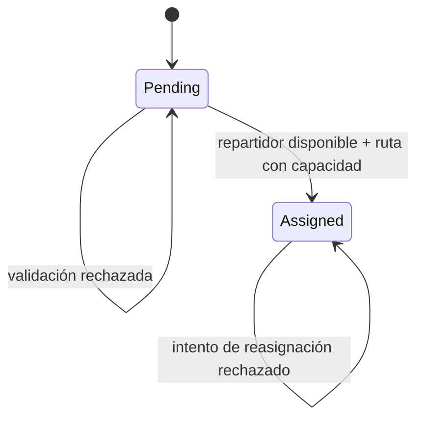

# Modelo de dominio

## Entidad raíz: `Delivery`

| Elemento | Tipo | Responsabilidad |
|---|---|---|
| `Id` | `DeliveryId` (objeto de valor) | Identidad única de la entrega |
| `Address` | `DeliveryAddress` (objeto de valor) | Destino de la entrega |
| `CourierId` | `CourierId?` (objeto de valor) | Repartidor asociado, si lo hay |
| `Status` | `DeliveryStatus` | Estado actual de la entrega |

`Delivery.AssignCourier(courierId)` es el punto que protege la regla de asignación. La entidad no consulta bases de datos ni servicios externos; Application valida la disponibilidad antes de invocar el comportamiento de dominio.

## Objetos de valor

- `DeliveryId(Guid Value)` identifica una entrega.
- `DeliveryAddress(string Value)` representa su destino; la validación formal del formato queda pendiente de requisitos del negocio.
- `CourierId(Guid Value)` identifica un repartidor sin exponer GUIDs sin tipo.
- `DeliveryStatus` expresa `Pending`, `Assigned` y los estados posteriores que se acuerden. Los estados finales y la cancelación no están definidos en el material disponible.

Los objetos de valor son inmutables y comparables por valor.

## Estados y transición relevante

No se modelan transiciones de entrega, cancelación o devolución más allá del flujo solicitado.

## Invariantes

1. Una entrega no puede recibir otra asignación mientras tenga un repartidor activo.
2. Solo se asigna a un repartidor elegible/disponible.
3. No se asigna una entrega a una ruta sin capacidad.
4. La operación rechazada no altera la asignación original.
5. La transición a `Assigned` debe guardarse con la asociación y su trazabilidad.

La regla de stock del PDF aplica a confirmación de pedidos, no a este flujo. Se conserva en el dominio logístico general, fuera del caso de uso de asignación.

